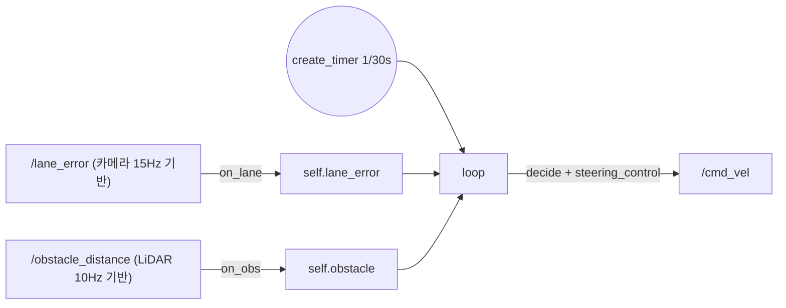

# ROS 2 제어 노드: 콜백은 저장만, 계산은 타이머에서 (제어 주기 정하기)

## 2026-11-05 — Lab 2 `turtle_goal.py`에서 on_pose와 control_loop를 나눈 이유

### 두 가지 구조
- **A. 이벤트 구동**: 구독 콜백 안에서 바로 계산하고 발행한다. 제어 주기 = 센서 도착 주기다.
- **B. 시간 구동**: 콜백은 **최신값을 저장만** 하고, **`create_timer`**로 정해진 주기마다 계산하고 발행한다.

```python
# ros2_4h_lab/ros2_ws/src/mini_av/mini_av/turtle_goal.py:36-44
    def on_pose(self, msg):
        self.pose = msg

    def control_loop(self):
        if self.pose is None:
            return
        gx = self.get_parameter("goal_x").value
        gy = self.get_parameter("goal_y").value
        cmd = Twist()
```
turtlesim처럼 센서가 하나뿐이면 A도 동작한다. 하지만 실차에서는 아래 이유로 제어 노드에 **B**를 쓴다.

### 이유 ① 주기가 다른 센서 여러 개를 합쳐야 한다
시뮬레이터부터 센서마다 주기가 다르다.
```python
# ros2_4h_lab/ros2_ws/src/mini_av/mini_av/sim_node.py:61-64
        self.dt = 1 / 60
        self.create_timer(self.dt, self._physics)
        self.create_timer(1 / 15, self._camera)
        self.create_timer(1 / 10, self._scan)
```
카메라 15Hz, LiDAR 10Hz다. A 방식으로 하면 "카메라 콜백에서 계산할까, LiDAR 콜백에서 할까"를 정해야 하고, 어느 쪽이든 다른 센서 값은 오래된 채로 섞인다. B 방식은 각 콜백이 자기 값만 갱신하고, 타이머가 **두 최신값을 함께** 보고 판단한다.


```python
# ros2_4h_lab/ros2_ws/src/mini_av/mini_av/controller_node.py:35-51
        self.create_subscription(Float32, "/lane_error", self.on_lane, 10)
        self.create_subscription(Float32, "/obstacle_distance", self.on_obs, 10)
        self.pub = self.create_publisher(Twist, "/cmd_vel", 10)
        self.pub_state = self.create_publisher(String, "/drive_state", 10)
        self.dt = 1 / 30
        self.create_timer(self.dt, self.loop)

    def on_lane(self, msg):
        self.lane_error = msg.data

    def on_obs(self, msg):
        self.obstacle = msg.data

    def loop(self):
        p = lambda n: self.get_parameter(n).value  # noqa: E731
        err = self.lane_error
        self.lost_time = self.lost_time + self.dt if math.isnan(err) else 0.0
```
`turtle_goal.py`는 이 구조를 센서 하나로 미리 연습하는 코드다.

### 이유 ② PID의 dt가 일정해야 한다
D항은 `(이번 오차 − 지난 오차) / dt`다. 타이머를 쓰면 `dt`가 고정된다(controller는 1/30초). A 방식에서는 dt가 메시지 도착 간격을 따라가는데, 네트워크나 CPU 상황에 따라 0.03초였다가 0.1초가 되는 식으로 흔들린다. 그러면 같은 오차 변화에도 D값이 튀어서 조향이 떨린다. I항(적분)도 dt를 곱해 누적하므로 마찬가지다.

### 이유 ③ 센서가 끊겨도 루프가 돈다 → 안전장치를 넣을 수 있다
A 방식에서는 센서가 멈추면 계산도 멈추고 **마지막 명령이 남는다**. B 방식에서는 타이머가 계속 돌기 때문에 "데이터를 마지막으로 받은 지 N초가 넘으면 정지" 같은 로직을 넣을 수 있다. 위 controller 51줄의 **`lost_time`**이 그 예다. 차선을 못 본(NaN) 시간을 루프마다 `dt`씩 누적한다.

### 이유 ④ 필요 이상으로 계산하지 않는다
pose는 약 62Hz로 오지만 제어는 20Hz면 충분하다. 남는 CPU는 라즈베리파이에서 이미지 처리에 쓴다.

### 제어 주기는 어떻게 정하나: "대상이 얼마나 빨리 변하나"
거북이의 최대 속도가 약 2라면 한 주기(0.05초) 동안 0.1 움직인다. 화면(11)의 약 1%라서 그 사이에 수정할 일이 거의 없다. 62Hz로 계산하면 거의 같은 명령을 3번씩 보내는 셈이다.
- **너무 빨라도 얻는 게 없다**: 모터나 서보의 반응 속도에는 한계가 있고, 입력(카메라 15~30Hz)이 그보다 자주 바뀌지 않으며, CPU만 쓴다.
- **너무 느리면 안 된다**: 2Hz라면 0.5초에 한 번 수정하니까 그 사이에 커브에서 차선을 벗어난다.
- **기준**: 대상이 변하는 속도보다 충분히(몇 배) 빠르게, 하지만 센서 갱신이나 하드웨어 반응 속도보다 크게 빠를 필요는 없다. turtle_goal은 20Hz, mini_av controller는 30Hz다.

### 콜백에서 바로 처리하는 게 맞는 경우: 변환 노드
입력 하나를 가공해서 바로 내보내는 노드는 A가 자연스럽다. 새 데이터가 와야만 할 일이 생기기 때문이다.
```python
# ros2_4h_lab/ros2_ws/src/mini_av/mini_av/lane_detect_node.py:27-38
        self.create_subscription(Image, "/camera/image_raw", self.on_image, 10)
        self.pub = self.create_publisher(Float32, "/lane_error", 10)
        self.pub_dbg = self.create_publisher(Image, "/lane/debug", 1)
        self.get_logger().info("lane_detect 시작 (%s)" % self.algo.__name__)

    def on_image(self, msg):
        img = np.frombuffer(msg.data, np.uint8).reshape(msg.height, msg.step)[:, :msg.width]
        t0 = time.perf_counter()
        err = self.algo.find_lane_center(img, self.cam, self.get_parameter("lane_width").value,
                                         self.state)
        ms = (time.perf_counter() - t0) * 1000
        self.pub.publish(Float32(data=float(err)))
```
`obstacle_node.py`의 `on_scan`도 같은 패턴이다.
- **변환 노드**(센서 → 가공값): 콜백에서 바로 처리한다.
- **제어 노드**(여러 값 → 명령): 콜백은 저장만 하고, 타이머로 일정하게 계산한다.

### 단점과 동시성
- B 방식에서는 데이터가 최대 한 주기(20Hz면 50ms) 늦게 반영된다. 소형 차량 속도에서는 보통 무시할 수준이다.
- 기본 `rclpy.spin`(SingleThreadedExecutor)은 콜백을 **하나씩 순서대로** 실행한다. 그래서 `control_loop`가 `self.pose`를 읽는 도중에 `on_pose`가 덮어쓰는 경쟁 상태가 생기지 않는다. MultiThreadedExecutor와 재진입 가능한 콜백 그룹을 쓰면 이 보장이 사라지므로 락이 필요하다.
