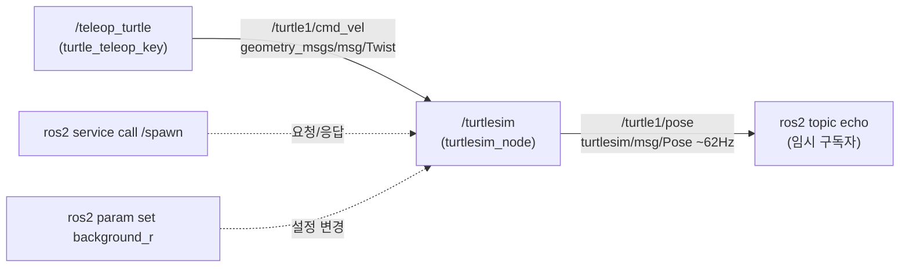
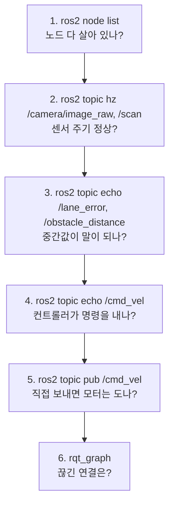

# ROS 2 CLI 기초 (turtlesim) 와 실제 자율주행 디버깅에서의 쓰임

## 2026-11-05 — ros2_4h_lab Lab 1: turtlesim으로 node / topic / service / parameter 익히기

### turtlesim이란
ROS 2에 기본으로 들어 있는 **연습용 2D 거북이 시뮬레이터**다. 11×11 좌표 평면(왼쪽 아래가 (0,0))의 가운데 `(5.54, 5.54)`에 `turtle1`이 생성되고, 지나간 자리에 선이 그려진다. 진짜 모바일 로봇과 똑같이 **`cmd_vel` 토픽에 `geometry_msgs/msg/Twist`를 보내서 움직인다**. 그래서 여기서 배운 명령이 실차에 그대로 이어진다.

### 명령어 문법: `ros2 <대상> <동작> [인자]`
`node`, `topic`, `service`, `param`, `interface`, `launch`, `bag` 같은 대상만 바꾸면 된다. 이름은 `/`로 시작하고(`/turtlesim`, `/turtle1/cmd_vel`), 타입은 `<패키지>/<msg|srv|action>/<이름>` 형식이다.


두 노드는 서로를 직접 알지 못한다. **토픽 이름과 메시지 타입이 같으면** 연결된다(발행/구독의 느슨한 결합).

```bash
# 프로젝트 코드 아님 — Lab 1 명령 모음 (ros2_4h_lab/README.md Lab 1)
ros2 run turtlesim turtlesim_node        # T1: GUI 창
ros2 run turtlesim turtle_teleop_key     # T2: 이 터미널에 포커스를 둔 채 방향키
ros2 node list
ros2 topic list -t
ros2 topic echo /turtle1/pose
ros2 topic hz /turtle1/pose
ros2 topic pub --rate 10 /turtle1/cmd_vel geometry_msgs/msg/Twist "{linear: {x: 1.5}, angular: {z: 1.0}}"
ros2 service call /spawn turtlesim/srv/Spawn "{x: 2.0, y: 2.0, theta: 0.0, name: 'turtle2'}"
ros2 param set /turtlesim background_r 200 && ros2 service call /clear std_srvs/srv/Empty
rqt_graph
```

### 명령별 의미와 출력
- **`ros2 run <패키지> <실행파일>`**: 노드 하나를 실행한다. 노드가 도는 동안 터미널이 붙잡혀 있는 건 정상이고, Ctrl+C로 끈다.
- **`ros2 node list`**: 실행 중인 노드 목록이다. 여기서는 `/teleop_turtle`, `/turtlesim`. 자세히 보려면 `ros2 node info /turtlesim`.
- **`ros2 topic list -t`**: 토픽과 타입 목록이다. `/turtle1/cmd_vel [geometry_msgs/msg/Twist]`, `/turtle1/pose [turtlesim/msg/Pose]`, `/turtle1/color_sensor`, 그리고 시스템 토픽 `/rosout`, `/parameter_events`가 나온다.
- **`ros2 topic echo`**: 터미널이 임시 구독자가 되어 메시지를 출력한다. Pose는 `x, y, theta(라디안, 0=동쪽), linear_velocity, angular_velocity`이고, `---`가 메시지 구분선이다.
- **`ros2 topic hz`**: 발행 주기를 잰다. turtlesim의 pose는 약 **62.5Hz**다.
- **`ros2 topic pub`**: 내가 직접 발행한다. `--rate 10`은 초당 10회, `--once`는 1회다.
  - **Twist** = `linear{x,y,z}`(m/s) + `angular{x,y,z}`(rad/s)다. 2D 차량은 **`linear.x`(전진)와 `angular.z`(회전, +는 왼쪽)만** 쓴다.
  - `x=1.5, z=1.0`이면 원을 그린다. 반지름은 v/ω = 1.5다.
  - 계속 보내야 하는 이유: turtlesim은 명령이 약 1초 끊기면 멈춘다. 통신이 끊겨도 폭주하지 않게 하는 **안전 타임아웃**이고, 실차도 같은 원리다.
- **`ros2 service call`**: **토픽 = 계속 흘려보내는 방송, 서비스 = 요청 1번에 응답 1번(전화)**. `/spawn`은 `Spawn_Response(name='turtle2')`를 돌려주고, `/turtle2/*` 토픽이 새로 생긴다. 타입 폴더가 `msg`가 아니라 `srv`다.
- **`ros2 param set`**: 실행 중에 노드 설정값을 바꾼다. 성공하면 `Set parameter successful`. `&&`는 ROS 문법이 아니라 bash 문법으로, 앞 명령이 성공하면 뒤 명령을 실행한다. `/clear`(`std_srvs/srv/Empty`)가 새 배경색으로 다시 칠하고 궤적을 지운다.
- **`rqt_graph`**: 노드(타원)와 토픽(화살표)을 그림으로 보여주는 GUI다. 빠진 게 보이면 새로고침 버튼을 누르고 Hide 체크박스를 해제한다.

### 실제 자율주행에서의 쓰임 (turtlesim → 실차 대응)
| turtlesim | 자율주행 (mini_av / PiCar-X) |
|---|---|
| `/turtlesim` | 시뮬레이터 `mini_sim` 또는 카메라·LiDAR·모터 드라이버 |
| `/teleop_turtle` | `controller` 노드 |
| `/turtle1/cmd_vel` | `/cmd_vel` (같은 Twist) |
| `/turtle1/pose` | `/camera/image_raw`, `/scan`, `/odom` |
| `background_r` | PID 게인 `kp/kd`, `speed`, 차선 threshold, 정지 거리 |
| `/spawn`, `/clear` | 시뮬레이터 리셋, 주행 모드 전환 |

- **`node list`**: 주행 전에 노드가 다 살아 있는지 확인한다. 하나가 빠졌으면 시작하자마자 죽은 것이다.
- **`topic list -t`**: 토픽 이름 오타나 타입 불일치를 찾는다. 이 문제는 **오류 없이 데이터만 안 들어와서** 찾기 어렵다.
- **`topic echo`**: `/lane_error`의 **부호**(차가 오른쪽으로 쏠렸는데 값이 음수인가?)와 `/cmd_vel`의 포화(±최대치 진동 = 게인 과다)를 확인한다. 이미지는 `rqt_image_view`나 rviz2로 본다.
- **`topic hz`**: 카메라가 30Hz가 아니라 8Hz로 나오면 CPU나 와이파이 병목이다. **"알고리즘은 맞는데 실차에서만 이상하다"면 hz부터** 확인한다.
- **`topic pub`**: 다른 노드 없이 부분만 테스트한다. `/cmd_vel`을 직접 보내서 모터 방향과 조향 부호를 확인하고, 가짜 장애물 거리를 넣어 FSM 정지 동작을 확인한다. 실차는 바퀴를 띄우고 저속으로 테스트하고, 끝나면 `--once "{}"`로 정지 명령을 보낸다.
- **`service call`**: 리셋, 모드 전환, 캘리브레이션처럼 한 번만 하면 되고 결과 확인이 필요한 일에 쓴다.
- **`param set` / `param dump`**: 코드를 고치거나 다시 빌드하지 않고 현장에서 튜닝한다(대회장 조명이 다르면 threshold만 조정). 잘 맞춘 값은 `ros2 param dump /controller > params.yaml`로 저장해서 `config/params.yaml`로 관리한다.
- **`rqt_graph`**: 끊긴 화살표(이름 불일치)를 찾고, 팀이나 보고서용으로 구조를 캡처한다.

### 실차가 안 움직일 때 점검 순서

위에서부터 내려가다가 **처음으로 이상한 단계**가 문제 위치다.

### 자주 막히는 곳
- 방향키가 안 먹힘: teleop을 실행한 터미널에 포커스가 없다.
- `ros2: command not found`: 그 터미널에서 `source /opt/ros/jazzy/setup.bash`를 안 했다. (2026-11-10부터 팀 배포판은 Jazzy. 예전 Humble 컨테이너에서는 `/opt/ros/humble`)
- `Package 'mini_av' not found`: `source ~/ros2_ws/install/setup.bash`를 안 했다.
- 창이 안 보임: [[ros2-dev-environment]] 참고.
