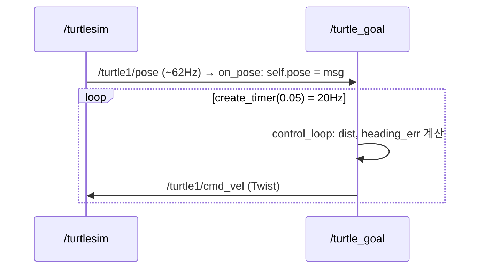

# rclpy 노드 뼈대와 목표점 P 제어 (turtle_goal)

## 2026-11-05 — ros2_4h_lab Lab 2: `turtle_goal.py`로 첫 ROS 2 Python 노드 작성

### 큰 그림: 센서 구독 → 계산 → 명령 발행
Lab 1에서 사람이 방향키로 하던 일(teleop 노드)을 **내 코드가 대신**한다. `/turtle1/pose`(현재 위치)를 구독하고, 목표까지의 거리와 방향을 계산해서, `/turtle1/cmd_vel`(속도 명령)을 발행한다. 이 구조는 Lab 3의 차선 추종 `controller_node`와 같은 모양이다.



### rclpy 노드의 4가지 뼈대: 파라미터 · 구독 · 발행 · 타이머
```python
# ros2_4h_lab/ros2_ws/src/mini_av/mini_av/turtle_goal.py:19-37
class TurtleGoal(Node):
    def __init__(self):
        super().__init__("turtle_goal")
        # 1) 파라미터 선언 (실행할 때 --ros-args -p goal_x:=2.0 으로 바꿀 수 있다)
        self.declare_parameter("goal_x", 8.0)
        self.declare_parameter("goal_y", 8.0)
        self.declare_parameter("k_lin", 1.0)
        self.declare_parameter("k_ang", 4.0)

        self.pose = None
        # 2) 구독: 메시지가 올 때마다 on_pose 가 불린다
        self.create_subscription(Pose, "/turtle1/pose", self.on_pose, 10)
        # 3) 발행자
        self.pub = self.create_publisher(Twist, "/turtle1/cmd_vel", 10)
        # 4) 타이머: 20 Hz 로 control_loop 실행
        self.create_timer(0.05, self.control_loop)

    def on_pose(self, msg):
        self.pose = msg
```
- **`super().__init__("turtle_goal")`**: 노드 이름을 정한다. `ros2 node list`에 `/turtle_goal`로 나온다.
- **`declare_parameter(이름, 기본값)`**: 설정값을 코드에 직접 박지 않고 밖으로 뺀다. 실행할 때 `--ros-args -p goal_x:=2.0`으로 바꾸거나, 실행 중에 `ros2 param set /turtle_goal goal_x 9.0`으로 바꿀 수 있다. `control_loop`가 매번 `get_parameter`로 다시 읽기 때문에 실행 중 변경이 바로 반영된다.
- **`create_subscription(타입, 토픽, 콜백, 큐크기)`**: 메시지가 오면 **콜백**(`on_pose`)을 자동으로 호출하도록 등록한다. `10`은 처리가 밀릴 때 쌓아 두는 메시지 수(QoS depth)다.
- **`create_publisher`**: 송신기를 만든다. 실제 전송은 `self.pub.publish(cmd)`에서 한다.
- **`create_timer(0.05, ...)`**: 0.05초마다(20Hz) 제어 루프를 호출한다. 콜백과 타이머를 나누는 이유는 [[ros2-callback-vs-timer]] 참고.

```python
# ros2_4h_lab/ros2_ws/src/mini_av/mini_av/turtle_goal.py:56-66
def main():
    rclpy.init()
    node = TurtleGoal()
    try:
        rclpy.spin(node)
    except KeyboardInterrupt:
        pass
    finally:
        node.destroy_node()
        if rclpy.ok():
            rclpy.shutdown()
```
**`rclpy.spin`**이 이벤트 루프다. 직접 `while True`를 짜지 않아도 메시지가 도착하면 콜백을, 시간이 되면 타이머를 대신 호출한다. `ros2 run mini_av turtle_goal`은 `setup.py`의 entry point `turtle_goal = mini_av.turtle_goal:main`을 통해 이 `main()`을 실행한다.

### 목표점 제어 수학 (TODO 1~5)
```
            ● 목표 (gx, gy)
           /|
     dist /  | dy
         /   |
  거북이 ●────┘ dx        theta = 현재 바라보는 방향
```
```python
# ros2_4h_lab/ros2_ws/src/mini_av/mini_av/turtle_goal_solution.py:26-45
    def control_loop(self):
        if self.pose is None:
            return
        p = lambda n: self.get_parameter(n).value  # noqa: E731
        gx, gy = p("goal_x"), p("goal_y")
        dx, dy = gx - self.pose.x, gy - self.pose.y
        dist = math.hypot(dx, dy)
        cmd = Twist()
        if dist < 0.1:
            if not self.arrived:
                self.get_logger().info("도착! (%.2f, %.2f)" % (self.pose.x, self.pose.y))
                self.arrived = True
        else:
            self.arrived = False
            heading_err = math.atan2(dy, dx) - self.pose.theta
            heading_err = math.atan2(math.sin(heading_err), math.cos(heading_err))
            cmd.angular.z = p("k_ang") * heading_err
            # 방향이 크게 틀어졌을 때는 제자리 회전 먼저
            cmd.linear.x = min(p("k_lin") * dist, 2.0) * max(0.0, math.cos(heading_err))
        self.pub.publish(cmd)
```
- **`self.pose is None`이면 return**: 아직 위치를 한 번도 받지 못했다.
- **`Twist()`는 모든 값이 0**이다. 아무것도 안 채우고 발행하면 "정지" 명령이 된다.
- **거리**: `math.hypot(dx, dy)` = √(dx²+dy²)(피타고라스).
- **목표 방향**: `math.atan2(dy, dx)`는 −π~π를 돌려준다. `atan(dy/dx)`를 쓰면 (1,1)과 (−1,−1)의 비율이 같아서 **사분면을 구분하지 못한다**. atan2는 dx와 dy의 부호를 따로 보기 때문에 구분한다.
- **각도 정규화 `atan2(sin e, cos e)`**: 목표가 +170°이고 거북이가 −170°를 보고 있으면 그냥 뺀 값은 +340°다. 그러면 왼쪽으로 거의 한 바퀴를 돈다. 정규화하면 각도가 360° 주기라는 성질을 이용해 −180°~180°로 접혀서 **−20°**(오른쪽으로 20°)가 된다. 이걸 빼먹으면 가끔 쓸데없이 한 바퀴 도는 버그가 생긴다.
- **전진 속도 조절 `max(0, cos e)`**: 정면이면 1, 옆(90°)이면 0, 등 뒤면 음수인데 0으로 자른다. 그래서 목표가 옆이나 뒤에 있으면 **제자리 회전부터** 하고 전진하지 않는다. `min(…, 2.0)`은 최고 속도 제한이다.
- **도착 판정**: 정확히 0이 될 때까지 기다리면 끝나지 않으므로 **허용 오차 0.1**을 둔다. 타이머가 20Hz라서 그냥 로그를 찍으면 초당 20줄이 나온다. `self.arrived` 플래그로 **한 번만** 찍는다.
- **`self.get_logger().info`**: ROS식 print다. 시간과 노드 이름이 붙는다.

### P 제어 (Proportional) 와 게인
**명령 = 게인 k × 오차**. 오차가 크면 세게, 작으면 약하게 반응한다. 그래서 목표에 가까워질수록 저절로 감속해서 부드럽게 멈춘다.

| `k_ang` | 동작 |
|---|---|
| 0.5 | 회전이 느려서 크게 돌아서 도착한다 |
| 4.0 (기본) | 빠르게 방향을 맞추고 거의 직선으로 간다 |
| 10.0 이상 | 휙 돈다. 제어 주기에 비해 너무 크면 지나쳤다 되돌아오면서 흔들린다 |

**"작으면 둔하고, 크면 흔들린다"**는 감각이 Lab 3 차선 추종(PD)의 `kp` 튜닝에 그대로 이어진다. 오차가 "목표 방향과의 차이"에서 "차선 중심에서 벗어난 정도"로 바뀔 뿐이다.

### 실행 (Docker 기준)
```bash
# 프로젝트 코드 아님 — 실행 예시
source ~/ros2_ws/install/setup.bash     # 새 터미널마다
ros2 run mini_av turtle_goal --ros-args -p goal_x:=2.0 -p goal_y:=8.0
ros2 param set /turtle_goal k_ang 0.5   # 실행 중 튜닝
ros2 run mini_av turtle_goal_solution   # 정답 동작 비교
```
teleop은 꺼 둔다. 같은 `cmd_vel`에 두 노드가 발행하면 명령이 섞인다.
